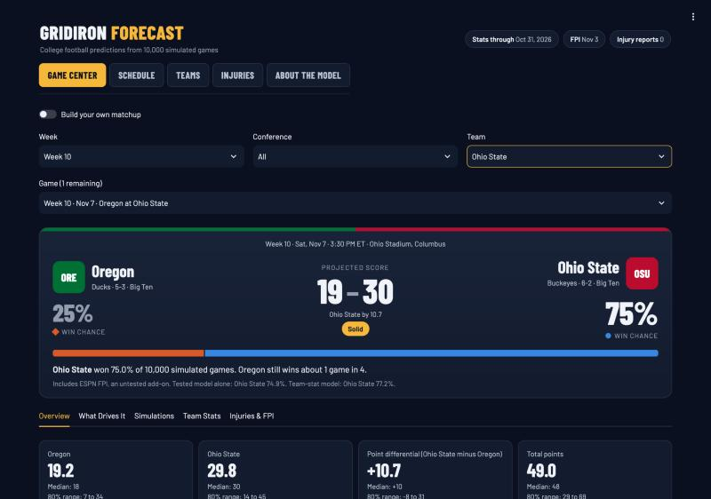
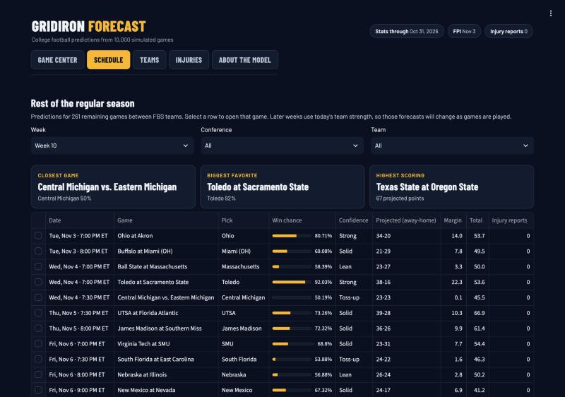
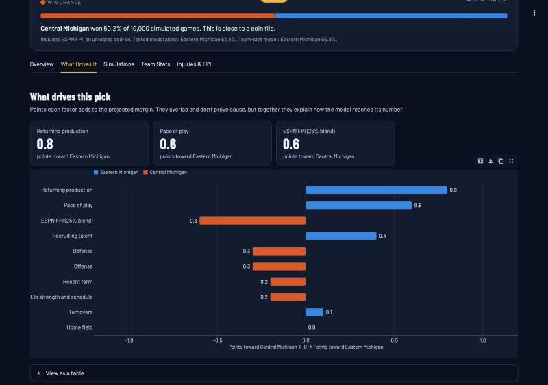

# Gridiron Forecast

A college football prediction app. Pick any remaining FBS game of the regular season and get win chances,
projected scores, 10,000 simulated outcomes, team stats, ESPN FPI, official injury reports, and the factors
behind the pick. Predictions come from a statistical model trained on historical data and tested on games it
never saw, plus a clearly labeled, untested FPI and injury add-on. No language model picks a winner.



| | |
|---|---|
|  |  |

*Screenshots from November 3, 2026, using team data through October 31, 2026.*

## Results

The final evaluation ran once on 2,398 FBS games from 2023-25, using a model frozen beforehand.

| Forecast | Accuracy | Log loss (lower is better) | Margin MAE | Total MAE |
|---|---:|---:|---:|---:|
| Listed betting line (benchmark, timing unverified) | not comparable | 0.5213 | 11.99 | 12.68 |
| **Monte Carlo simulation** | **71.6%** | **0.5376** | **12.47** | **12.84** |
| Team-stat model | 71.6% | 0.5404 | 12.45 | n/a |
| CFBD's Elo (benchmark) | 70.8% | 0.5529 | n/a | n/a |
| Our Elo model | 70.2% | 0.5589 | 13.28 | n/a |
| Coin flip | 50.0% | 0.6931 | n/a | n/a |

- The simulation and team-stat model are effectively tied, and both clearly beat Elo.
- The listed betting lines are more accurate than this model.
- It does best on mismatches and early-season games, and struggles on bowl games.

Read [what the results mean](docs/FINAL_EVALUATION.md) or the
[permanent report](reports/final_evaluation/final_evaluation.md).

## Setup

You need [uv](https://docs.astral.sh/uv/), which installs the right Python version for you. Everything
used here is free.

```bash
git clone https://github.com/billytheballer/SportsSimulation.git
```

```bash
cd SportsSimulation
```

```bash
uv sync --extra dev
```

To download data, you also need a free API key from
[CollegeFootballData.com](https://collegefootballdata.com/key) (email only, no card):

```bash
cp .env.example .env
```

Then paste your key into `.env`. Git ignores this file, so your key won't be published.

## Run the app

```bash
uv run streamlit run streamlit_app.py
```

The app opens at `http://localhost:8501`. It needs a model bundle in `bundles/`, which you build using the
steps below. It reads only that bundle, so it doesn't need your key while running.

| Page | What's there |
|---|---|
| **Game Center** | A dropdown of every remaining game, with filters by week, conference, and team. Win chances, projected scores and ranges, simulations, team stats, FPI, injuries, and what drives the pick. You can also build your own matchup |
| **Schedule** | Predictions for all remaining games, with the closest games and biggest favorites. Select a row to open that game |
| **Teams** | Rankings, projected wins, and each team's remaining games, results, and season stats |
| **Injuries** | Official reports on file, with their sources and how they affect forecasts |
| **About the Model** | How it works, how accurate it is, where to be careful, and what the terms mean |

The header always shows how current the stats, FPI, and injury reports are, and warns you when data is out of date.
If only the 2022 demonstration is built, the app says so and never presents it as a current forecast.

## Build the model bundles

Downloading the historical data takes about 295 API calls of your 1,000 free monthly calls. The results are
saved in `data/`, so it only happens once.

```bash
uv run cfbsim fetch
```

```bash
uv run cfbsim fetch-stats
```

```bash
uv run cfbsim build-demo
```

The model settings come from the saved Stage 3 report, so you don't need to repeat that step.

## Keep the current season up to date

The production model trains on 2016-25. New 2026 games update team ratings and stats, but they don't
refit the model. Run these after games finish, typically once a week:

```bash
uv run cfbsim update-season
```

```bash
uv run cfbsim build-production
```

The current-season forecast also uses ESPN FPI and official availability reports, which were never part of the
final evaluation. The app shows the tested model's number beside the adjusted one. See
[FPI and player availability](docs/ADJUSTMENTS.md) to set this up, including one `cfbsim fit-availability` run
of about 120 API calls.

A typical weekly update uses about 20 API calls. Check your usage with:

```bash
uv run cfbsim usage
```

A fresh copy of this project needs the final evaluation files in `reports/final_evaluation/`, which
are included in the repository. The production model refuses to build without them.

## Other commands

Simulate a matchup in the terminal, using team data through 2022:

```bash
uv run cfbsim simulate "Ohio State" Oregon --neutral
```

Reproduce the earlier development results, which never load 2023-25:

```bash
uv run cfbsim backtest
```

```bash
uv run cfbsim stage2
```

Run the tests. They use made-up games, so they need no key or data:

```bash
uv run pytest
```

## How it works

1. **Elo ratings** track each team's strength game by game.
2. **Team stats** become opponent-adjusted running averages built only from earlier games.
3. **A team-stat model** (regularized logistic regression) estimates win probability.
4. **A score model** (ridge regression) predicts each team's expected points from its offense, the
   opponent's defense, pace, site, and more. It never sees a win probability.
5. **A Monte Carlo simulation** draws real pairs of scores from past games with similar expectations, and
   plays out overtime when regulation ends tied.

See the [model card](docs/MODEL_CARD.md) for a one-page summary, [how the simulation works](docs/SIMULATION.md)
for assumptions and realism tests, and the [roadmap](docs/ROADMAP.md) for the stages.

## How the code is organized

| Path | Purpose |
|---|---|
| `streamlit_app.py` | App entry point |
| `src/cfbsim/app/` | Interface and charts. Nothing else imports Streamlit |
| `src/cfbsim/predictor.py` | The only part of the project the interface calls |
| `src/cfbsim/bundle.py` | Saved snapshots of fitted models and team data |
| `src/cfbsim/production.py` | The 2026 production model and season updates |
| `src/cfbsim/final_eval.py` | The one-time final evaluation and its safeguards |
| `src/cfbsim/elo.py`, `features.py`, `model.py`, `scoring.py`, `simulate.py` | The models |
| `src/cfbsim/client.py`, `games.py`, `stats.py` | Data download and cleaning |
| `reports/` | Saved evaluation results |

## How leakage is prevented

- **Forecast first, update second.** Ratings and team stats are read before a game's data touches them.
  Tests rewrite later results and each game's own stats, and confirm that forecasts for that game and
  earlier ones don't change.
- **Allowlisted columns.** Only named fields leave the data layer, so post-game values can't reach a model.
- **Time-ordered splits.** Warm-up 2014-15, training and selection 2016-20, development 2021-22, final
  evaluation 2023-25. Code raises an error if a model is fit on seasons outside its window.
- **A one-time final test.** See [how the test was protected](docs/FINAL_EVALUATION.md).
- **No invented data.** Bad rows are dropped and counted. If a team has no history for a stat, the model
  treats that as "no known edge" with a flag saying the value was unknown. Betting lines are never inputs.

## Limitations

The tested model can't see injuries, player availability, suspensions, weather, or coaching changes. The added
FPI and availability layer hasn't been tested, and it covers only reports on file and offensive players. Simulated
score ranges run slightly wide. Bowl games are close to a coin flip for this model. This project is
for analysis and education, and isn't betting advice.

## Deploying for free

This hasn't been deployed yet. The hosted app needs no API key, since it only reads a saved bundle. See the
[publishing checklist](docs/PUBLISHING.md) for each step, including what a public bundle contains.

## Data and license

Data provided by [CollegeFootballData.com](https://collegefootballdata.com), under
[its own terms](https://collegefootballdata.com/terms). This repo holds no raw game data, because CFBD's terms
don't allow committing it to a public repo. See [data sources](docs/DATA_SOURCES.md) for what's free.
Not official NCAA, conference, or school data. Team and conference names belong to their owners and are
used only to identify teams.

The source code is under the [MIT License](LICENSE).
